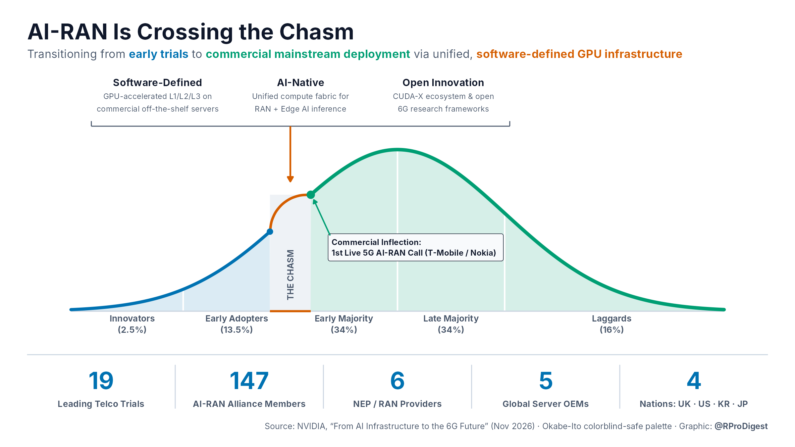

# AI-RAN Is Crossing the Chasm

An explanatory data visualisation built in R with `ggplot2`. It places AI-RAN on Rogers' diffusion-of-innovations curve, splits the curve at Moore's chasm, and shows three architectural pillars as the bridge from early trials to mainstream commercial deployment.



---

## What the chart shows

| Element | Meaning |
|---|---|
| **Blue curve** | Pre-chasm market: Innovators and Early Adopters (early trials) |
| **Grey gap** | Moore's chasm, centred on the Early Adopter / Early Majority boundary (μ − σ) |
| **Vermilion bridge** | The three pillars carrying AI-RAN across the chasm |
| **Green curve** | Post-chasm market: Early Majority, Late Majority and Laggards (mainstream deployment) |
| **Milestone callout** | Commercial inflection: 1st Live 5G AI-RAN Call (T-Mobile / Nokia) |
| **KPI strip** | Ecosystem figures: 19 leading telco trials, 147 AI-RAN Alliance members, 6 NEP / RAN providers, 5 global server OEMs, 4 nations (UK, US, Korea, Japan) |

### The three pillars

1. **Software-Defined**: GPU-accelerated L1/L2/L3 on commercial off-the-shelf servers
2. **AI-Native**: unified compute fabric for RAN + Edge AI inference
3. **Open Innovation**: CUDA-X ecosystem and open 6G research frameworks

---

## Requirements

- R ≥ 4.1 (uses the native pipe `|>`)
- ggplot2 ≥ 3.5.0 recommended (for the `linewidth` argument on labels)

Install the packages:

```r
install.packages(c("tidyverse", "ggtext", "patchwork", "ragg", "systemfonts", "glue", "scales"))
```

**Optional font:** the script uses [Inter](https://rsms.me/inter/) if it is installed and falls back to the system `sans` font otherwise. Restart R after installing the font.

---

## Usage

```r
source("ai_ran_chasm_v2.R")
```

The script writes **`ai_ran_crossing_the_chasm_v2.png`**: 12 × 6.75 in at 200 DPI (2400 × 1350 px, 16:9), saved with `ragg` for crisp text. The size suits the X/Twitter timeline and slide decks.

### Configuration

| Setting | Where | Effect |
|---|---|---|
| `dark_mode` | Section 1 | `TRUE` switches to a dark presentation background |
| `mu`, `sd_c` | Section 2 | Centre and spread of the diffusion curve; every divider and the chasm position are derived from these |
| `chasm_left` / `chasm_right` | Section 2 | Chasm width (default ±0.20 around μ − σ) |
| `pillars_df` | Section 2 | Pillar titles and descriptions (ggtext markdown/HTML) |
| `kpi_df` | Section 4 | KPI figures and labels |
| `ggsave()` | Section 5 | Output size, resolution and file name |

---

## Script structure

```
0. Typography      font detection (Inter → sans fallback)
1. Theme & palette Okabe-Ito colours, light/dark mode
2. Data            normal curve, chasm split, dividers, labels, pillars
3. Main plot       areas, curves, bridge, pillars, milestone, segment labels
4. KPI strip       five ecosystem metrics + caption
5. Combine/export  patchwork layout, ragg PNG
```

---

## Design notes

- **Statistically consistent segments.** Dividers sit at μ − 2σ, μ, μ + σ, and the chasm at μ − σ, so the shaded areas match Rogers' categories. Labels use Rogers' standard rounding (2.5 / 13.5 / 34 / 34 / 16 %). The exact normal-curve areas are 2.3 / 13.6 / 34.1 / 34.1 / 15.9 %.
- **Colour as legend.** The subtitle is coloured with `ggtext::element_markdown()`, so each phrase matches its part of the chart and no legend box is needed.
- **Colorblind-safe.** Uses the [Okabe-Ito](https://jfly.uni-koeln.de/color/) palette: blue `#0072B2`, bluish green `#009E73`, vermilion `#D55E00`.
- **Built for mobile.** The smallest text is about 8.5 pt at export size, so it stays legible on a phone screen.
- **Collision-free annotation.** Each pillar's title and description are rendered as a single `geom_richtext()` object, and the milestone label sits inside the post-chasm area with a short leader line.

---

## Data source

NVIDIA, *"From AI Infrastructure to the 6G Future"* (Nov 2026). The diffusion curve is a conceptual illustration (a normal distribution following Rogers' framework), not measured adoption data.

---

## Author

Graphic by **[@RProDigest](https://x.com/RProDigest)** on X.
